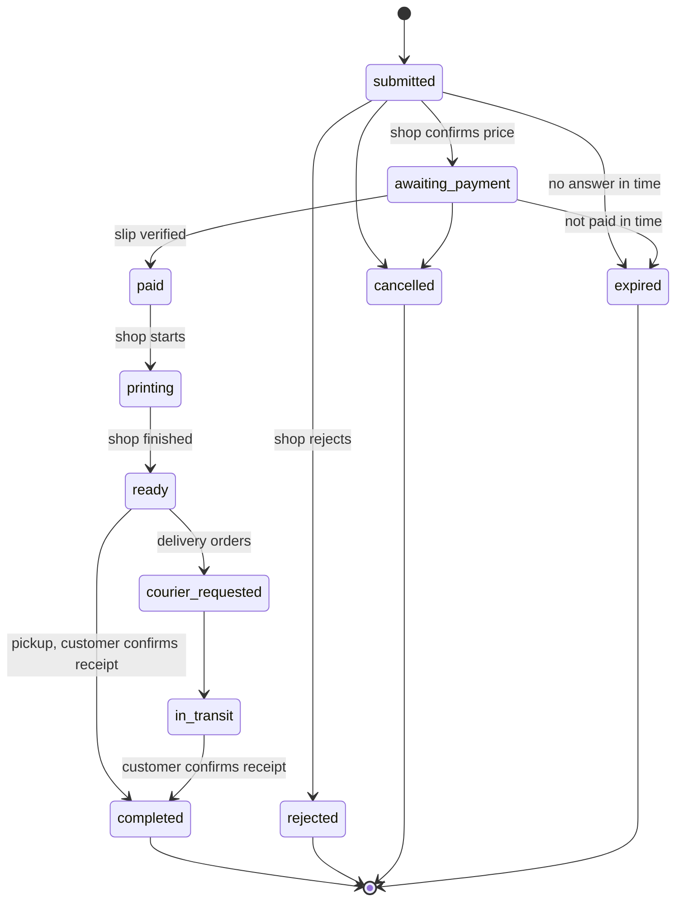

<div align="center">

# PrintGo

**Your file goes in. Your print comes home.**

One LINE Official Account that connects customers with many print shops:
send a file, pick a shop, pay, and pick it up or have it delivered.

[](https://github.com/CutieCat8/PrintGo/actions/workflows/ci.yml)


</div>

---

## Overview

**PrintGo** is a marketplace-style ordering service that lives inside LINE. Customers print
documents without hunting for a shop, calling for a price or walking in with a USB stick:

1. The customer sends a PDF or image through the LINE OA and chooses which pages to print.
2. They pick a nearby print shop and a pickup or delivery option.
3. The shop confirms the price and an estimated finish time.
4. The customer pays by PromptPay QR and uploads the transfer slip.
5. The shop prints. The customer collects the order, or a rider brings it home.

Shops work from a web dashboard (no LINE OA of their own). Admins review payments, settle
money with shops and handle exceptions.

> **ภาพรวม (ภาษาไทย)** PrintGo คือตัวกลางสั่งปริ้นผ่าน LINE OA เดียว สำหรับหลายร้านปริ้น
> ลูกค้าส่งไฟล์ → เลือกร้าน → ร้านยืนยันราคา → ลูกค้าจ่าย → ร้านปริ้น → ลูกค้ารับเอง หรือเรียกไรเดอร์ส่งถึงที่
> ร้านใช้แดชบอร์ดบนเว็บ ส่วนแอดมินตรวจการชำระเงินและโอนเงินให้ร้าน

## Table of contents

- [Features](#features)
- [How an order moves](#how-an-order-moves)
- [Tech stack](#tech-stack)
- [Project structure](#project-structure)
- [Getting started](#getting-started)
- [Configuration](#configuration)
- [Scripts](#scripts)
- [Testing and CI](#testing-and-ci)
- [Deployment](#deployment)
- [Engineering rules](#engineering-rules)
- [What is simulated](#what-is-simulated)
- [Documentation](#documentation)
- [Team and ownership](#team-and-ownership)
- [Contributing](#contributing)
- [License](#license)

## Features

**Customers (LINE / LIFF)**

- Sign in with LINE, no password.
- Upload PDFs and images (signed upload straight to private storage). Pages are counted in the
  browser; choose all pages or a range, with real page previews and a magnifier to check a page.
- Find shops by distance and opening hours. Per-file settings: colour or black-and-white,
  paper size, single or double sided, copies, plus optional extra services.
- See the price the shop confirmed (never a guess when a price is negotiated), pay with PromptPay
  QR, upload the slip.
- Live order progress, a delivery tracking card, and an in-order chat with the shop.
- LINE messages for every step (quote, payment, printing, ready, delivery, completed).

**Print shops (web dashboard)**

- Queue board: new orders, waiting for payment, to print, printing, ready for pickup, done
  (grouped by outcome with counts).
- Confirm or reject orders (a reason is required), set the price and the estimated finish time.
- Open, print or download customer files through short-lived signed links.
- Chat with the customer from a floating chat bubble, alerts with sound, and **Web Push** even
  when the tab is minimised.
- Settings: opening hours, prices per page, discount tiers, extra services, pause and resume.

**Admins**

- Approve shops, review payment slips, handle refunds and settlements, close or cancel orders,
  and enter courier results by hand.

## How an order moves

Every status change goes through one function, `transition()`, which checks who may do it.



After payment only an admin can cancel (with a refund). The full table, with who is allowed to
make each step, is in [`docs/CONTRACTS.md`](docs/CONTRACTS.md) section 4.

## Tech stack

| Area | Choice |
|---|---|
| App | Next.js 16 (App Router, Cache Components), React 19, TypeScript |
| UI | Tailwind CSS 4, hand-built design system in `src/components/ui`, SWR for data fetching |
| Database, auth, files | Supabase: Postgres, Auth (e-mail magic link for shops and admins), private Storage |
| Customer login | LINE LIFF (ID token verified on the server) |
| Validation | Zod |
| Payments | PromptPay QR (`promptpay-qr`), optional slip verification with SlipOK |
| Delivery | Provider interface with a manual provider (admin enters the result) and a Grab provider |
| Notifications | LINE Messaging API (Flex messages), Web Push (VAPID) for shops |
| PDF handling | `pdfjs-dist` (page count and previews in the browser) |
| Tests | Vitest |
| Hosting | Vercel (app) and Supabase (data) |

## Project structure

```text
src/
  app/
    liff/          customer screens (LINE LIFF)
    shop/          shop dashboard
    admin/         admin console
    login/ auth/   shop and admin sign-in
    api/
      liff/        customer API
      shop/        shop API
      admin/       admin API
      payments/    payment API (QR, slip)
      line/        LINE webhook
      delivery/    courier webhook
      cron/        expiry and file clean-up jobs
  components/      ui (design system), payment
  lib/
    domain/        pricing, order state machine, shops, chat (the business rules)
    client/        browser helpers, API client, mock API
    db/            Supabase clients and generated types
    auth/ line/ delivery/ payment/ push/
supabase/          migrations and sample seed data
scripts/           make-admin, rich menu installer and artwork
docs/              CONTRACTS.md, API.md, E2E.md, task files
```

## Getting started

**Prerequisites**

- Node.js 22.13 or newer (22.x), or Node 24 or newer
- For a local database: Docker and the Supabase CLI (installed as a dev dependency)

```bash
git clone https://github.com/CutieCat8/PrintGo.git
cd PrintGo
npm install
cp .env.example .env.local   # fill in what you need, see Configuration
npm run dev                  # http://localhost:3000
```

### Two ways to run

| Mode | How | Good for |
|---|---|---|
| **Mock** | `NEXT_PUBLIC_USE_MOCK=true` (the default in `.env.example`) | UI work with in-memory sample data, no Supabase or LINE needed |
| **Real** | `NEXT_PUBLIC_USE_MOCK=false` with Supabase and LINE values filled in | End-to-end work against the real API |

To open the customer screens without LINE while developing, leave `NEXT_PUBLIC_LIFF_ID` empty.

### Database

Schema and sample data live in `supabase/` (`migrations/` and `seed.sql`). The sample data is made up.

| Command | What it does |
|---|---|
| `npm run db:reset` | empty the **local** Supabase database (needs Docker), run the migrations, then the seed |
| `npm run db:reset:remote` | the same on the project linked with `npx supabase link`. **Erases that database**; the CLI asks you to confirm. Use a development project only |

Change the schema by adding a file with `npx supabase migration new <name>`. Never edit a
migration that others have already run. Apply migrations **before** deploying code that needs them.

### Signing in

- **Customers** sign in with LINE (LIFF). The browser sends the LIFF ID token as `Authorization: Bearer ...`.
- **Shops and admins** sign in at `/login` with an e-mail link (Supabase Auth). A new shop fills in
  its details after the first sign-in and waits for an admin to approve it.
- **Make someone an admin:** they sign in once at `/login`, then run `npm run make-admin -- their@email`.

### Developer shortcut

Outside production, send the header `x-dev-user` with an API request instead of signing in
(it is ignored in production):

| Header value | Acts as |
|---|---|
| `customer:00000000-0000-4000-8000-0000000000c1` | the sample customer |
| `shop:00000000-0000-4000-8000-0000000000a1` | sample shop A (`...a2` = B, `...a3` = C) |
| `admin` | an admin |

## Configuration

Copy [`.env.example`](.env.example) to `.env.local`. Never commit real values. Server-only
secrets must never use the `NEXT_PUBLIC_` prefix.

| Group | Variables |
|---|---|
| Supabase | `NEXT_PUBLIC_SUPABASE_URL`, `NEXT_PUBLIC_SUPABASE_ANON_KEY`, `SUPABASE_SERVICE_ROLE_KEY` (server only) |
| LINE | `NEXT_PUBLIC_LIFF_ID`, `LINE_CHANNEL_ID`, `LINE_CHANNEL_SECRET`, `LINE_CHANNEL_ACCESS_TOKEN` |
| Payment | `PLATFORM_PROMPTPAY_ID`, `SLIPOK_API_KEY`, `SLIPOK_BRANCH_ID`, `SLIPOK_RECEIVER_CONFIRMED` |
| Business rules | `PLATFORM_FEE_RATE`, `SHOP_RESPONSE_MINUTES`, `PAYMENT_WINDOW_MINUTES`, `DELIVERY_*` |
| Delivery | `DELIVERY_PROVIDER` (`manual` or `grab`), `GRAB_CLIENT_ID`, `GRAB_CLIENT_SECRET`, `GRAB_ENV` |
| Web Push | `NEXT_PUBLIC_VAPID_PUBLIC_KEY`, `VAPID_PRIVATE_KEY` (server only), `VAPID_SUBJECT` |
| App | `NEXT_PUBLIC_APP_URL`, `NEXT_PUBLIC_USE_MOCK`, `CRON_SECRET` |

`NEXT_PUBLIC_*` values are baked into the bundle at build time: after changing one, redeploy.
The full list and meaning of each variable is in `docs/CONTRACTS.md` section 8.

## Scripts

| Command | What it does |
|---|---|
| `npm run dev` | start the dev server |
| `npm run build` / `npm start` | production build and server |
| `npm run lint` | ESLint |
| `npm run typecheck` | `tsc --noEmit` |
| `npm test` | Vitest |
| `npm run format` | Prettier |
| `npm run db:reset` / `db:reset:remote` | rebuild the local or linked database from migrations and seed |
| `npm run make-admin -- <email>` | give an existing account the admin role |
| `npm run richmenu` | install the LINE rich menu (`scripts/assets/richmenu.png`) on the OA |
| `npm run payment:preview` | make a test PromptPay QR for 1.23 baht to check the account name and amount in a banking app (needs `PLATFORM_PROMPTPAY_ID`; do not confirm the transfer) |

## Testing and CI

Tests cover the parts where mistakes cost money or trust: pricing, the order state machine,
permissions, payments, delivery updates, chat and the client helpers.

```bash
npm run lint && npm run typecheck && npm test
```

GitHub Actions ([`ci.yml`](.github/workflows/ci.yml)) runs lint, typecheck, tests and a
production build on every pull request and on pushes to `main`. The build needs no secrets.
A manual end-to-end checklist for real devices is in [`docs/E2E.md`](docs/E2E.md).

## Deployment

1. **Supabase:** create a project, run every file in `supabase/migrations/` in order, set the
   Auth redirect URLs, and create the private Storage buckets `order-files`, `payment-slips`
   and `settlement-proofs`.
2. **Vercel:** import the repository and add the environment variables above. Redeploy after
   changing any `NEXT_PUBLIC_*` value.
3. **LINE:**
   - LIFF endpoint URL: `https://<your-domain>/liff`
   - Messaging API webhook URL: `https://<your-domain>/api/line/webhook`, then press Verify
   - Rich menu: put the artwork at `scripts/assets/richmenu.png` (2500 x 1686 px, under 1 MB), then run
     `npm run richmenu`. It replaces the previous menu and takes effect for every user immediately.
4. **Web Push:** generate a VAPID key pair, set the three `VAPID_*` variables, and let each shop
   press "Turn on notifications" once per device.
5. **Admin:** sign in once at `/login`, then `npm run make-admin -- you@example.com`.

Jobs under `src/app/api/cron/*` (order expiry, file clean-up) require
`Authorization: Bearer <CRON_SECRET>`. Expiry is also checked lazily whenever an order is read,
so the platform does not depend on a scheduler.

## Engineering rules

These are enforced in code and tests, and are the rules to protect when changing anything:

- **Money is an integer number of satang** (1 baht = 100) everywhere: database, API and code. It
  becomes baht only when drawn, through one `formatBaht()` helper. No floats.
- **Order status changes only through `transition()`** (`src/lib/domain/orders/transition.ts`),
  which uses an atomic conditional update and checks the actor.
- **Secrets stay on the server.** Service-role key, LINE secrets, SlipOK and Grab keys, the VAPID
  private key and the cron secret never reach the browser or the logs.
- **Every endpoint checks permission in code:** customers see only their own orders, shops only
  their own, admins see all. Row Level Security is on with no policies; the server uses the
  service role and does its own checks.
- **Customer files are private.** Uploads go to Storage with signed URLs, shops open them through
  short-lived signed links, and files are deleted 7 days after the order ends.
- **Shops never see the pickup code or the delivery recipient's name and phone.** This is checked at
  the API layer, not only hidden on screen.
- **Webhooks are idempotent** (a `webhook_events` table) and signature-checked.
- If a volume discount applies or an extra service is "price by agreement", the system never
  sends a price to the customer by itself: the shop must enter it first.
- After payment a customer cannot cancel; only an admin can, with a refund.

## What is simulated

Be clear about what is real and what is a stand-in:

- **Courier booking and tracking:** the Grab integration is behind a provider interface. The
  default `manual` provider has an admin enter the courier result. The rider tracking card in the
  customer app is a **screen-only simulation** (six seconds per stage, with a sample arrival
  window) until a real courier feed is connected. The customer's "received" button is what closes a
  delivery order.
- **Slip verification:** SlipOK is used when a key is configured; otherwise an admin approves slips
  by hand.
- **Settlement:** PrintGo collects the money first and an admin marks the transfer to each shop.
- **Data and prices in the seed** are sample values, not real shops, prices or delivery fees.
- **Alert sound:** the sound of a Web Push notification belongs to the operating system and cannot
  be changed. The dashboard plays its own tone while a tab is open.
- Shops using iPhone or iPad must add the dashboard to the Home Screen before Web Push works
  (iOS 16.4+). A computer or Android phone is recommended.
- Chat uses short polling, not WebSockets. Word and PowerPoint files are not supported: customers
  are asked to send a PDF.

## Documentation

| File | What it holds |
|---|---|
| [`docs/CONTRACTS.md`](docs/CONTRACTS.md) | the shared contract: tables, statuses, API shapes, money units, environment variables |
| [`docs/API.md`](docs/API.md) | endpoint reference |
| [`DECISIONS.md`](DECISIONS.md) | decisions taken and the ones still open, with the default used |
| [`docs/E2E.md`](docs/E2E.md) | manual end-to-end test checklist |
| [`docs/tasks/`](docs/tasks) | the work plan and per-person task files |
| [`CLAUDE.md`](CLAUDE.md) | rules for people and AI agents working in this repository |

## Team and ownership

Each area has an owner. Changing a file outside your own area goes through a pull request that the
owner reviews.

| Owner | Area |
|---|---|
| ยูริ (Yuri) | customer screens (`src/app/liff`), shop dashboard (`src/app/shop`), UI components, client helpers |
| อาร์ม (Arm) | payments, admin console, shop settings |
| พลุ (Plu) | customer and shop APIs, domain logic, cron jobs, API docs |
| ซี (Sea) | LINE, delivery, auth, database, scripts, configuration, CI and the other docs |

## Contributing

1. Read `CLAUDE.md`, `docs/CONTRACTS.md` and `DECISIONS.md` first. Do not invent field names;
   change contracts only after asking the owner.
2. Branch from `main`: `feat/<task>-<short-name>` or `fix/<short-name>`. Never push straight to `main`.
3. Write commit messages in English: `feat:`, `fix:`, `chore:`, `docs:`, `test:`. One commit per change, short body.
4. Add tests for anything that touches money, pricing, order status or permissions.
5. Before opening a pull request run `npm run lint && npm run typecheck && npm test`.
6. Do not commit `.env*` files (only `.env.example`).

## License

No license has been chosen yet. Until one is added, all rights are reserved by the authors.
